  
  
  
  

**Nick Nelson** here. Information Systems student at Universitas Atma Jaya Yogyakarta, Indonesia.

I like making things that feel like objects you could touch: a CRT that boots, a VHS tape you can pick up, a dino that races your friends. Right now I'm finishing a PS1-style horror game for iPhone.

Off the clock I'm student staff at my campus's student affairs and career office, where I build the student services portal.

Everything lives at [nick-project-1.vercel.app](https://nick-project-1.vercel.app).

 

## now playing

### [DINO with FRIENDS](https://dino-with-friends.nicknelsoon30.workers.dev)

The offline dino game, but you race your friends. Make a lobby, send the code, and everyone runs the same desert in real time. Crash early and you get to watch the rest.

`TypeScript` `React` `Cloudflare Workers` `Durable Objects` · [play it](https://dino-with-friends.nicknelsoon30.workers.dev) · [source](https://github.com/NickkkGG/dino-with-friends)

---

### Don't Let It In

A PS1-style horror game for iPhone. You work the night shift alone at a warnet, and every message, email and visitor could be a scam. Spot it, or let it in.

`Swift` `Metal` `iOS`

---

### [3D portfolio](https://nick-project-1.vercel.app)

My portfolio as one long 3D scroll: a lived-in room, a fall through the floor, CRTs hanging in the dark and VHS tapes for contact.

`Next.js` `React Three Fiber` `Three.js` `Blender` · [visit](https://nick-project-1.vercel.app) · [source](https://github.com/NickkkGG/Nick-Portofolio)

---

### also on air

[sitkul-uajy-mcp](https://github.com/NickkkGG/sitkul-uajy-mcp) · an MCP server for my campus LMS: courses, deadlines and materials, straight into an AI assistant. `TypeScript` `MCP`

## system check

## signal

<!-- Panels are drawn by scripts/ (npm run build); the signal is redrawn daily by .github/workflows/signal.yml. -->
